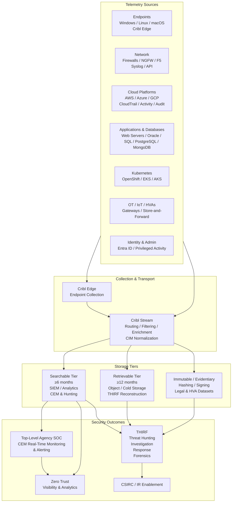

# Agency Logging Plan
## Implementation of CISA Logging Reference Architecture (LRA)  
### Aligned to OMB Memorandum M-26-14

**Agency:** [Agency Name]  
**Plan Version:** 1.0 (Initial Submission)  
**Submission Date:** [Insert Date ≤ November 18, 2026]  
**Submission Channel:** CyberScope  
**Plan Owner:** [Name], Chief Information Security Officer (CISO)  
**Document Status:** Ready for CISO/CIO concurrence and CyberScope submission  

**Related Artifacts:**  
- Endpoint Security Logging Data Models (https://github.com/Wvmwhite/Endpoint-Security-Data-Model-for-Logging- and local copies)  
- CISA Logging Reference Architecture (August 2026)  
- OMB M-26-14 (May 22, 2026)  
- CDM / HWAM / SWAM inventory  
- Zero Trust Maturity Model (Visibility & Analytics pillar) roadmap  

---

## 1. Scope and Governance

**Plan Owner:** [CISO Name], CISO  
**Accountable Stakeholders:**  
- SOC / CSIRC Lead  
- Endpoint, Network, Cloud, and Database Architecture Leads  
- CDM / HWAM / SWAM Program Manager  
- Component / Bureau CISOs  
- Privacy, Records Management, and Legal Counsel  
- OT / IoT / HVA System Owners  

**Review Cadence:**  
- Quarterly operational review  
- Within 30 calendar days of any published LRA update  
- After significant incidents, architecture changes, or maturity assessment results  

**Approval Status:** Pending CISO and CIO concurrence for initial submission.  

**Organizational Boundaries Covered:**  
All agency information systems (agency-owned, agency-operated, and third-party operated), including IT, cloud (IaaS/PaaS/SaaS), OT, IoT, High Value Assets (HVAs), and High Impact Systems. Federated components are required to make baseline and above-baseline telemetry available to the top-level agency SOC for CEM and THIRF.  

**Related Governance Artifacts:**  
Logging policy, records retention schedules, Zero Trust implementation plan, and the Endpoint Security Logging Data Models used as the technology-specific field and event baseline.

---

## 2. CEM and THIRF Implementation Approach

The agency will implement a **source-appropriate collection with common downstream handling** operating model (LRA recommended default).  

**Core Principles:**  
- Outcome-driven: Every telemetry decision is tied to the ability to answer specific CEM or THIRF questions.  
- Normalized representation using Splunk Common Information Model (CIM) as the durable enterprise schema, while preserving source-native context for recoverability.  
- Hybrid dataflow supporting both real-time CEM and longer-term THIRF reconstruction.  
- Prioritization of HVAs, identity, privileged activity, network, endpoint, and cloud control-plane telemetry.

**Operational Steps:**  
1. Inventory all in-scope assets via CDM/HWAM/SWAM.  
2. Map assets to the nine LRA telemetry categories and the corresponding Endpoint Security Logging Data Models.  
3. Deploy collection using Cribl Edge (endpoints/nodes) and native/API/syslog mechanisms where appropriate.  
4. Route, filter, enrich, and normalize via Cribl Stream to CIM-aligned fields.  
5. Deliver to searchable operational tier (SIEM / analytics) for CEM and to retrievable tiers for THIRF.  
6. Implement validation, gap tracking, and continuous improvement.

**Technology-Specific Baselines:**  
The agency adopts the completed Endpoint Security Logging Data Models as the authoritative definition of required events, critical fields, CIM mappings, and investigative questions for:  
Windows OS, Linux OS, macOS, Web Servers (IIS/Apache/Nginx), Relational and NoSQL Databases, Kubernetes, AWS/Azure/GCP platform services, Firewalls/NGFWs, F5 BIG-IP, and Nutanix.

These models directly support LRA minimum event fidelity and the Zero Trust Visibility & Analytics pillar.

---

## 3. Minimum Baseline Implementation

The agency will meet M-26-14 Appendix B minimum requirements and LRA Section 6 / Appendix D baseline coverage and fidelity.

**Inventory and Coverage:**  
CDM/HWAM/SWAM will be used to ensure logging coverage of IT/OT/IoT assets. Target initial coverage aligned to Level 1 maturity (70% inventory, 50% searchable/retrievable).

**Timestamps:**  
All logs will include accurate timestamps synchronized via NTP to an agency-designated traceable time source (preference for sources traceable to USNO or NIST).

**Required Logging Activities (M-26-14 Appendix B):**  
- Identity used for operations  
- Source and destination network address information (protocol, port, session attributes)  
- Object/resource/data access, modification, or destruction  
- Privilege level changes  
- Infrastructure changes (add/remove/modify endpoints)  
- Security tooling detections and alerts  
- Indicators of compromise and anomalous activity  
- Impact quantification and attack vector reconstruction  
- Automated alerts for the above  

**Minimum Event Fidelity (LRA):**  
Each event will capture who, what, when, where, action, object/resource, result/outcome, and provenance. Common fields required for cross-source correlation will be normalized to CIM.

**Implementation Method:**  
Gap analysis will be performed against the Endpoint Security Logging Data Models for every major technology stack. Must-Have events and fields from those models constitute the agency baseline.

---

## 4. Additional Mission/Risk-Based Logging (Above Baseline)

Above-baseline decisions are driven by the agency’s threat environment, risk profile, mission requirements, HVA status, and identified visibility gaps (LRA Section 9).

**Documented Above-Baseline Activities:**  
- Enhanced process, command-line, and file integrity monitoring on HVAs and High Impact Systems.  
- Extended searchable window or immutable handling for identity, privileged, and HVA-related datasets.  
- OT/IoT telemetry via gateways and store-and-forward where native logging is limited.  
- AI system activity (prompts, outputs, decisions, lineage) with preservation of raw records.  
- Zero Trust policy decision points (north-south and east-west) for identity, device, network, application, and data.  
- Higher-fidelity cloud control-plane and database audit logging beyond minimum.

These decisions will be reviewed quarterly and updated in subsequent plan versions.

---

## 5. Retention, Access, and Protection

**Retention Model (M-26-14 Appendix B + LRA):**  
- **Actively searchable:** Minimum 6 months (supports CEM and operational hunting).  
- **Retrievable:** Minimum 12 months (supports THIRF reconstruction and forensics).  
- **Immutable / Evidentiary:** Designated datasets (HVAs, high-impact investigations, legal holds) with hashing, signing, and strict access controls.

**Storage Design Rationale:**  
Tier placement is driven by operational outcomes, not vendor defaults. Searchable data resides in low-latency tiers (SIEM/analytics). Retrievable data moves to cost-efficient object or cold storage with defined retrieval SLAs. Evidentiary data receives additional integrity protections.

**Availability to Top-Level SOC:**  
Required logs are available to the agency SOC via centralized storage, federated query, or hybrid model. Retrieval procedures are documented and tested.

**Protection of Logging Infrastructure and Data:**  
- Logging infrastructure treated as critical systems (segmentation, least privilege, encryption in transit and at rest).  
- Sensitive data minimization and redaction where appropriate.  
- Logging of administrative access to the logging platform itself.  
- Procedures for lawful external requests (CISA, FBI, OIG, courts) including scoping, integrity preservation, transformation documentation, and export.

---

## 6. Validation and Maturity Measurement

**Validation Approach:**  
The agency will use LRA Appendix C (Priority Architecture and Design Decision Checklist) and Appendix E (Validation and Operational Readiness Checklist) as living assessment tools.  

Status categories: Clear / Partial / Inadequate / Gap (design) and Validated / Partially Validated / Not Validated / Known Gap with Remediation (operational).

**Validation Methods:**  
- Synthetic event injection and end-to-end pipeline testing  
- Monitoring of collection, transport, parsing, normalization, and delivery latency/completeness  
- Periodic tabletop and technical drills  
- Gap tracking with owners and target dates  
- Quarterly maturity scoring against M-26-14 Appendix C elements

**Maturity Targets (from LRA publication ~August 20, 2026):**  
- **Level 1 (Initial/Basic):** December 18, 2026 — 70% inventory coverage; searchable/retrievable for ≥50% of assets; 6-month searchable / 12-month retrievable baseline.  
- **Level 2 (Intermediate):** February 16, 2027 — Higher coverage percentages and improved operations.  
- **Level 3 (Advanced):** July 6, 2027 — ≥90% inventory; high collection coverage; tuned detections; stronger integrity and access controls.

**Current State Summary (to be updated with agency data):**  
[Insert current inventory coverage %, known gaps by telemetry category or technology model, pipeline health status, and retention tier status.]

**Improvement Roadmap:**  
Prioritized gaps (coverage, fidelity, searchability, correlation) with owners, dependencies, and dates aligned to the maturity milestones. Quarterly review and plan updates.

---

## 7. Architecture Diagram (Data Flow)

**Diagram Notes:**  
- Sources map to LRA telemetry categories and the Endpoint Security Logging Data Models.  
- Cribl Edge + Stream provide consistent collection, cost control, and CIM normalization.  
- Storage tiers explicitly separate searchable (CEM), retrievable (THIRF), and immutable (evidentiary) data.  
- All required telemetry is available to the top-level SOC.

---

## 8. Stack Comparison and Gap Analysis Guidance

For each technology stack, the agency will use the corresponding Endpoint Security Logging Data Model’s Stack Comparison Template to document:  
- Current log sources enabled  
- Critical fields captured vs. required  
- CIM normalization status  
- Searchable/retrievable coverage  
- Known gaps and remediation owners  

This process directly supports LRA validation requirements and maturity measurement.

---

## 9. Contacts and Resources

- **CISA Logging Questions:** logging@cisa.dhs.gov  
- **CyberScope Platform Support:** CyberScopeHelp@cisa.dhs.gov  
- **LRA and Template:** https://www.cisa.gov/resources-tools/resources/logging-reference-architecture  
- **Endpoint Security Logging Data Models:** https://github.com/Wvmwhite/Endpoint-Security-Data-Model-for-Logging-

---

**Prepared for CyberScope Submission**  
This document addresses all minimum content areas in LRA Appendix B, Table B-1. Agency-specific quantitative data (asset counts, current coverage percentages, named owners, and detailed gap lists) should be inserted prior to final submission. The Endpoint Security Logging Data Models provide the field-level and question-driven baseline required by the LRA.
