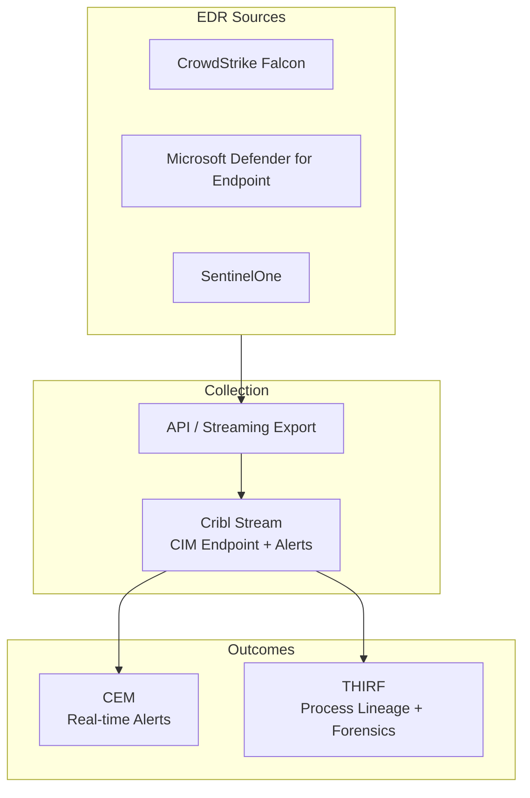

# Endpoint Security Logging Data Model: Endpoint Detection and Response (EDR) / Security Tool Alerts

**Version:** 1.0  
**Date:** 2026-10-12  
**Alignment:** OMB M-26-14 (CEM + THIRF), CISA LRA (Category 6: Security Tool Alerts and Detections; supports Endpoint/System and Privileged), Splunk CIM (primary: Endpoint, Intrusion_Detection, Malware; secondary: Alerts), Zero Trust Visibility & Analytics.

**Primary solutions:** CrowdStrike Falcon, Microsoft Defender for Endpoint, SentinelOne, Carbon Black, Trellix, common federal EDR platforms.

## 1. Category Overview
EDR and security tooling provide high-fidelity detections, process telemetry, and behavioral alerts that are essential for real-time CEM and for correlating with OS and network data during THIRF.

## 2. Operational Purpose & Security Rationale
Security tool alerts deliver the “what is suspicious right now” signal required by M-26-14 and the LRA. They enable rapid triage, enrichment of endpoint activity, and forensic context that native OS logs alone often lack.

## 3. Key Questions the Model Must Answer
- What detection or alert fired, on which asset, at what time, with what severity and technique (MITRE ATT&CK)? (CEM, THIRF)
- What process, file, or network activity triggered the alert, and what was the parent/child lineage? (THIRF, Investigation)
- Was the activity blocked, quarantined, or only alerted? What was the outcome? (CEM, Response)
- Can the alert be correlated to identity, network, and cloud events using common fields? (Zero Trust, THIRF)
- What is the underlying raw telemetry that supports the detection? (Forensics)

## 4. Required Event Classes / Log Sources
| Log Source | Priority | Notes |
|------------|----------|-------|
| Detection / Alert events | Must Have | Severity, technique, status |
| Process execution telemetry | Must Have | Command line, hash, parent |
| File and registry activity (EDR) | Should Have | Creation, modification, quarantine |
| Network connection events (EDR) | Should Have | Dest IP, port, process context |
| Response actions | Must Have | Isolate, kill, quarantine results |
| Sensor health / status | Should Have | Online/offline, version |

## 5. Critical Attributes / Fields Table
| Field Name | Description | Why It Matters (CEM/THIRF) | CIM Data Model & Field Mapping | Example Values | Collection Notes |
|------------|-------------|----------------------------|--------------------------------|----------------|------------------|
| timestamp | Detection time (UTC) | Timeline | `_time` | 2026-10-12T16:45:00Z | |
| dest | Hostname / agent ID | Asset | Endpoint.dest | WORKSTATION-042 | |
| user | Associated user | Identity | Endpoint.user | DOMAIN\analyst | |
| signature / alert_name | Detection name | What fired | Intrusion_Detection.signature | Suspicious PowerShell | |
| severity | Critical/High/Medium/Low | Prioritization | Intrusion_Detection.severity | high | |
| action | allowed, blocked, quarantined | Outcome | Endpoint.action / Malware.action | blocked | |
| process / process_name | Image and command line | Execution context | Endpoint.process | powershell.exe -enc ... | |
| file_hash | SHA256 | IoC | Endpoint.file_hash | a1b2c3d4... | |
| mitre_technique | ATT&CK ID | Hunting | Custom | T1059.001 | |
| vendor_product | EDR platform | Source | Endpoint.vendor_product | CrowdStrike Falcon | |
| raw_event / event_id | Native detection ID | Forensics | Custom | CS-12345 | Preserve raw |

## 6. CIM Alignment
**Primary:** Endpoint (Processes, Filesystem), Intrusion_Detection, Malware  
**Secondary:** Alerts (if using CIM Alerts model)

Map detections to Intrusion_Detection or Malware; process telemetry to Endpoint.Processes.

## 7. CEM, THIRF & CSIRC Enablement Notes
Directly enables real-time SOC alerting and automated response. Provides the high-fidelity context needed for THIRF when correlated with IAM, network, and OS logs. Treat as core CEM telemetry.

## 8. Collection, Normalization & Maturity Guidance
Prefer API or Cribl Stream connectors for structured export. Normalize to CIM Endpoint + Intrusion_Detection. Pitfall: alerts without underlying process/file context. Strongly supports Collection Coverage and Log Management maturity.

## 9. Stack Comparison Template
| Requirement | Current State | Gap | Remediation | Owner | Target Date |
|-------------|---------------|-----|-------------|-------|-------------|
| Detection alerts with severity & technique | | | | | |
| Process + command line + hash | | | | | |
| Response action outcomes | | | | | |
| CIM Endpoint / Intrusion_Detection mapping | | | | | |
| Correlation ID / raw preservation | | | | | |

