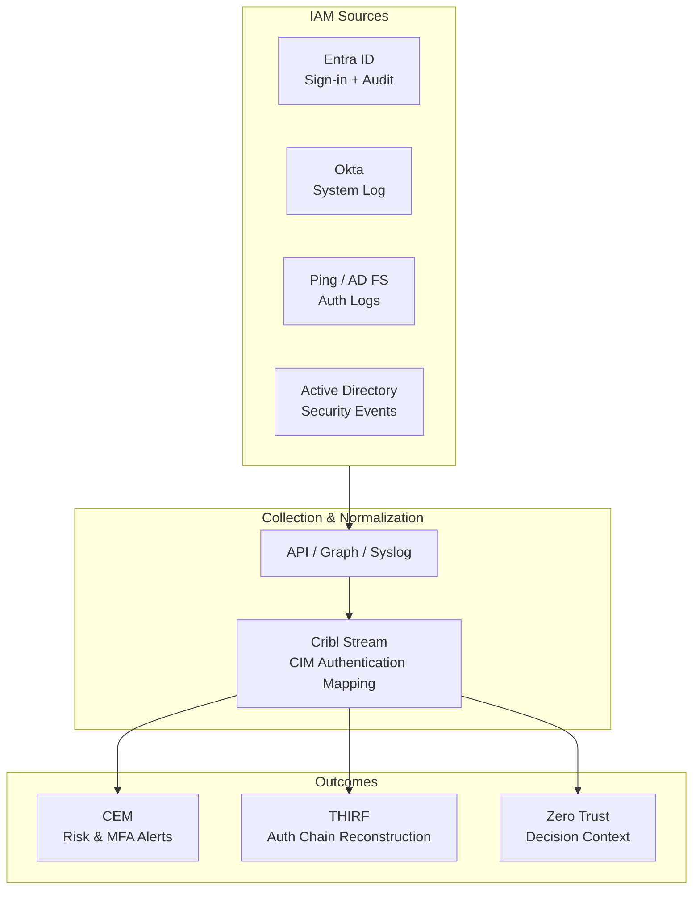

# Endpoint Security Logging Data Model: Identity and Access Management (IAM / Enterprise IdP)

**Version:** 1.0  
**Date:** 2026-10-12  
**Alignment:** OMB M-26-14 (CEM + THIRF), CISA LRA (Category 1: Identity and Authentication Activity; supports Privileged/Admin and Zero Trust), Splunk CIM (primary: Authentication; secondary: Change, Endpoint), Zero Trust Visibility & Analytics.

**Primary solutions:** Microsoft Entra ID (Azure AD), Okta, Ping Identity, AD FS, Active Directory (as IdP), common federal SSO/federation platforms.

## 1. Category Overview
Enterprise Identity and Access Management platforms are the authoritative source for authentication decisions, MFA, conditional access, and identity lifecycle events. They are foundational to Zero Trust continuous verification and the LRA’s first telemetry category.

## 2. Operational Purpose & Security Rationale
IAM logs provide the “who” and the decision context (success/failure, MFA, risk signals, policy evaluation) required for CEM detection of credential misuse, impossible travel, and privilege escalation, and for THIRF reconstruction of initial access and lateral movement. Critical for Zero Trust Visibility & Analytics.

## 3. Key Questions the Model Must Answer
- Who authenticated (success or failure), from where, with what method (password, MFA, certificate, passwordless), and what was the risk or conditional access outcome? (CEM, THIRF, Zero Trust)
- Was MFA challenged, completed, bypassed, or failed? What factor was used? (CEM, Investigation)
- What privileged or service account activity occurred, including non-person identities? (CEM, THIRF)
- Were accounts created, disabled, password reset, or group memberships changed? (Change, THIRF)
- What application or resource was accessed as a result of the authentication decision? (Zero Trust, Investigation)

## 4. Required Event Classes / Log Sources
| Log Source | Priority | Notes |
|------------|----------|-------|
| Authentication / Sign-in logs | Must Have | Success, failure, MFA, risk, conditional access |
| Audit / Directory logs | Must Have | User, group, app, role changes |
| Conditional Access / Policy evaluation | Must Have | Policy name, result (grant/deny/block) |
| MFA / Authentication method logs | Must Have | Factor used, registration, failure |
| Privileged role / PIM / JIT elevation | Should Have (Must for HVAs) | Activation, approval, duration |
| Non-person / service principal activity | Must Have | App registrations, service accounts |
| Risk detections / Identity Protection | Should Have | Impossible travel, anonymous IP, malware-linked |

## 5. Critical Attributes / Fields Table
| Field Name | Description | Why It Matters (CEM/THIRF) | CIM Data Model & Field Mapping | Example Values | Collection Notes |
|------------|-------------|----------------------------|--------------------------------|----------------|------------------|
| timestamp | Event time (UTC) | Timeline correlation | `_time` | 2026-10-12T15:30:00Z | NTP synchronized |
| user / src_user | Principal name or UPN | Identity attribution | Authentication.user | jane.doe@agency.gov | Include object ID |
| src / src_ip | Source IP or location | Origin of attempt | Authentication.src | 203.0.113.45 | Geo if available |
| action | success, failure, challenge | Outcome | Authentication.action | success | |
| app / dest | Application or resource accessed | What was targeted | Authentication.app | Microsoft 365 | |
| authentication_method | Password, MFA, FIDO, cert | Method strength | Authentication.authentication_method | MFA - Authenticator | |
| mfa_result | completed, failed, bypassed | MFA effectiveness | Custom or Authentication | completed | Critical for Zero Trust |
| risk_level / risk_detail | Identity risk signal | Anomaly detection | Custom | high - impossible travel | |
| policy_name / policy_result | Conditional Access outcome | Policy enforcement | Custom | Block legacy auth - deny | |
| vendor_product | IdP platform | Source context | Authentication.vendor_product | Entra ID | |
| session_id / correlation_id | Trace identifier | Cross-event correlation | Custom | abc123-def456 | Preserve for THIRF |

## 6. CIM Alignment
**Primary:** Authentication (tag=authentication)  
**Secondary:** Change (tag=change), Endpoint (for device context if present)

Key mappings: sign-in events → Authentication; directory changes → Change; preserve correlation IDs for pivoting.

## 7. CEM, THIRF & CSIRC Enablement Notes
Supports real-time alerting on failed MFA bursts, high-risk sign-ins, and privileged elevations. Enables full reconstruction of authentication chains and initial access. Retention: searchable 6 months / retrievable 12 months. High-value for HVAs and High Impact Systems.

## 8. Collection, Normalization & Maturity Guidance
Collect via native API (Microsoft Graph, Okta System Log API), syslog, or Cribl Edge/Stream. Normalize to CIM Authentication. Common pitfalls: missing correlation IDs, incomplete MFA context, service principal under-representation. Contributes to Inventory Visibility, Collection Coverage, and Collection Operations maturity elements.

## 9. Stack Comparison Template
| Requirement | Current State | Gap | Remediation | Owner | Target Date |
|-------------|---------------|-----|-------------|-------|-------------|
| Sign-in success/failure + MFA | | | | | |
| Conditional Access policy results | | | | | |
| Directory / role change auditing | | | | | |
| Service principal / non-person identity | | | | | |
| CIM Authentication normalization | | | | | |
| Searchable 6 mo / Retrievable 12 mo | | | | | |

