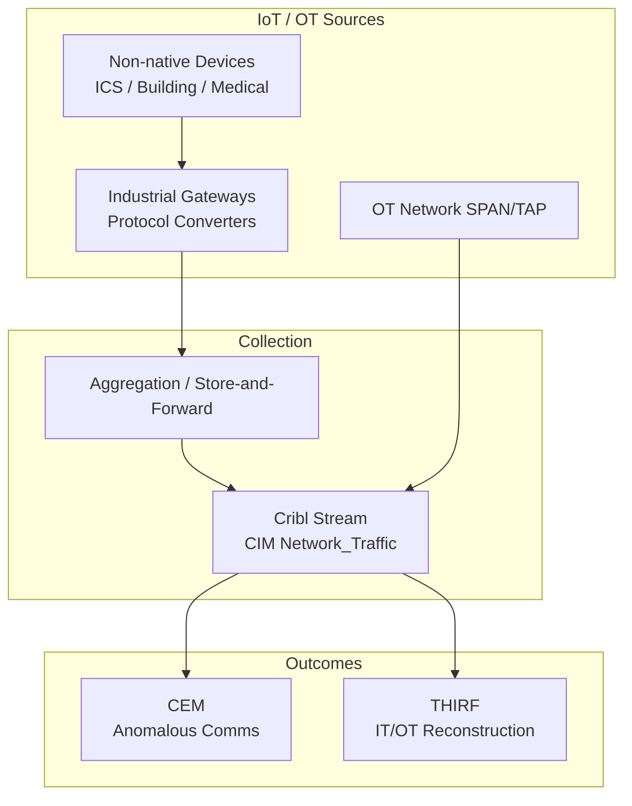

# Endpoint Security Logging Data Model: IoT and OT Device Activity

**Version:** 1.0  
**Date:** 2026-10-12  
**Alignment:** OMB M-26-14 (CEM + THIRF), CISA LRA (Category 9: IoT and OT Device Activity, including environments without native logging), Splunk CIM (primary: Network_Traffic, Endpoint; secondary: Change), Zero Trust Visibility & Analytics.

**Primary solutions:** Building automation, industrial control systems (ICS), medical devices, badge readers, facility systems, and any IoT/OT lacking native logging (collected via gateways, polling, or store-and-forward).

## 1. Category Overview
IoT and OT devices are explicitly in scope under M-26-14 and the LRA. Many lack native high-fidelity logging, requiring gateway aggregation, protocol translation, or periodic polling to achieve minimum usable fidelity.

## 2. Operational Purpose & Security Rationale
Provides visibility into device state changes, communications, and anomalous behavior in environments that are often mission-critical or safety-related. Supports detection of lateral movement into OT and reconstruction of incidents that cross IT/OT boundaries.

## 3. Key Questions the Model Must Answer
- Which device communicated with what peer, when, and using what protocol? (CEM, Network)
- What state changes, commands, or configuration modifications occurred? (THIRF, Change)
- Can the activity be attributed to a user, service, or automated process? (Identity, Investigation)
- Was the device online, offline, or exhibiting anomalous behavior? (CEM)
- How is provenance and timing preserved when using gateways or store-and-forward? (Forensics)

## 4. Required Event Classes / Log Sources
| Log Source | Priority | Notes |
|------------|----------|-------|
| Gateway / protocol converter logs | Must Have | Aggregated from non-native devices |
| Network flow / span from OT segments | Must Have | Source/dest, protocol, volume |
| Device state / heartbeat | Should Have | Online/offline, firmware |
| Command / configuration change events | Must Have (where available) | Write operations, setpoints |
| Authentication to device or HMI | Should Have | Operator logons |
| Store-and-forward buffer events | Must Have | Delivery assurance |

## 5. Critical Attributes / Fields Table
| Field Name | Description | Why It Matters (CEM/THIRF) | CIM Data Model & Field Mapping | Example Values | Collection Notes |
|------------|-------------|----------------------------|--------------------------------|----------------|------------------|
| timestamp | Event or gateway receipt time | Timeline (note skew) | `_time` | 2026-10-12T17:00:00Z | Document clock source |
| src / src_ip | Device or source address | Origin | Network_Traffic.src | 10.50.1.25 | |
| dest / dest_ip | Peer or controller | Target | Network_Traffic.dest | 10.50.1.10 | |
| protocol | Modbus, BACnet, OPC, etc. | Context | Network_Traffic.protocol | modbus | |
| action | read, write, connect, alert | Outcome | Network_Traffic.action | write | |
| device_id / hostname | Asset identifier | Inventory | Endpoint.dest | HVAC-Controller-03 | Map to HWAM |
| user / operator | Attributed identity if available | Attribution | Authentication.user | operator1 | Often absent |
| vendor_product | Gateway or device type | Source | Custom | OT Gateway v2 | |
| provenance | Collection method | Forensics | Custom | gateway-aggregated | Critical for non-native |

## 6. CIM Alignment
**Primary:** Network_Traffic  
**Secondary:** Endpoint, Change

Normalize gateway and flow data to Network_Traffic; device identity to Endpoint where possible.

## 7. CEM, THIRF & CSIRC Enablement Notes
Enables detection of anomalous OT communications and supports cross-domain incident reconstruction. Special consideration for timing accuracy and store-and-forward integrity. Aligns with LRA specialized environment patterns.

## 8. Collection, Normalization & Maturity Guidance
Use industrial gateways, SPAN/TAP, or polling collectors feeding Cribl Stream. Preserve original timestamps and collection method. Common pitfall: loss of attribution and timing fidelity. Contributes to Inventory Visibility and Collection Coverage for OT/IoT assets.

## 9. Stack Comparison Template
| Requirement | Current State | Gap | Remediation | Owner | Target Date |
|-------------|---------------|-----|-------------|-------|-------------|
| Device inventory mapped to HWAM | | | | | |
| Network flows from OT segments | | | | | |
| State / command events (where native) | | | | | |
| Gateway aggregation with provenance | | | | | |
| CIM Network_Traffic normalization | | | | | |

