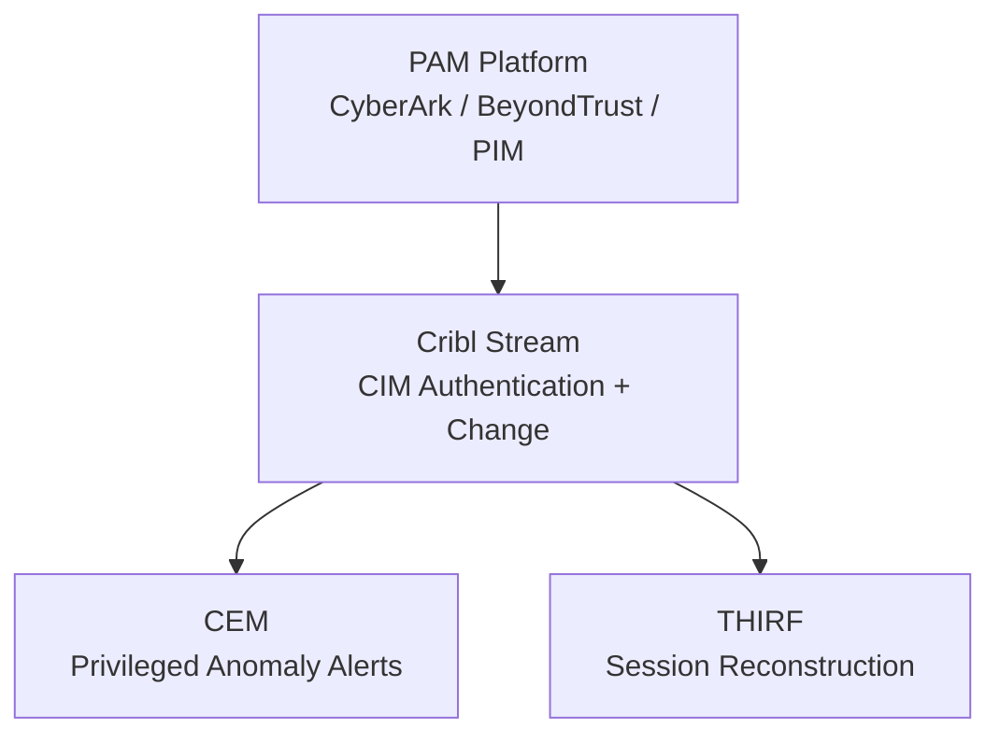

# Endpoint Security Logging Data Model: Privileged Access Management (PAM)

**Version:** 1.0  
**Date:** 2026-10-12  
**Alignment:** OMB M-26-14 (CEM + THIRF), CISA LRA (Category 4: Privileged and Administrative Activity), Splunk CIM (primary: Authentication, Change; secondary: Endpoint), Zero Trust Visibility & Analytics.

**Primary solutions:** CyberArk, BeyondTrust, Delinea (Thycotic), Microsoft Privileged Identity Management (PIM), common federal PAM platforms.

## 1. Category Overview
PAM solutions control, monitor, and audit privileged account usage, just-in-time elevation, and session activity. They are critical for detecting and reconstructing privilege abuse.

## 2. Operational Purpose & Security Rationale
Provides high-assurance logging of privileged sessions, credential check-out, and elevation events that native OS and IAM logs often lack in sufficient detail. Directly supports LRA privileged activity fidelity and Zero Trust least-privilege verification.

## 3. Key Questions the Model Must Answer
- Who checked out or used a privileged credential, when, from where, and for what target system? (CEM, THIRF)
- Was the session recorded, and what commands or actions were performed? (Forensics, THIRF)
- Were just-in-time elevations approved, by whom, and for how long? (Change, Zero Trust)
- Did any privileged activity occur outside PAM controls? (CEM, Investigation)

## 4. Required Event Classes / Log Sources
| Log Source | Priority | Notes |
|------------|----------|-------|
| Credential check-out / check-in | Must Have | User, target, duration |
| Session start / end / recording metadata | Must Have | |
| Command / keystroke audit (where enabled) | Should Have (Must for HVAs) | |
| JIT elevation / approval workflow | Must Have | Approver, justification |
| Password rotation / vault events | Should Have | |
| Policy violation / break-glass | Must Have | |

## 5. Critical Attributes / Fields Table
| Field Name | Description | Why It Matters | CIM Mapping | Example | Collection Notes |
|------------|-------------|----------------|-------------|---------|------------------|
| timestamp | Event time | Timeline | `_time` | 2026-10-12T18:00:00Z | |
| user | Requesting user | Identity | Authentication.user | admin.jane | |
| dest | Target system / account | What was accessed | Authentication.dest | SERVER01\Administrator | |
| action | checkout, session_start, elevate | Outcome | Authentication.action | checkout | |
| session_id | Unique session | Correlation | Custom | PAM-789 | |
| approver | Who approved JIT | Accountability | Custom | manager.bob | |
| vendor_product | PAM platform | Source | Authentication.vendor_product | CyberArk | |

## 6. CIM Alignment
**Primary:** Authentication, Change  
Map check-out and elevation to Authentication and Change.

## 7. CEM, THIRF & CSIRC Enablement Notes
Enables alerting on unusual privileged usage and full session reconstruction. High priority for HVAs.

## 8. Collection, Normalization & Maturity Guidance
API or syslog export via Cribl Stream. Normalize to CIM Authentication/Change.

## 9. Stack Comparison Template
| Requirement | Current State | Gap | Remediation | Owner | Target Date |
|-------------|---------------|-----|-------------|-------|-------------|
| Credential check-out auditing | | | | | |
| Session metadata | | | | | |
| JIT approval workflow | | | | | |
| CIM mapping | | | | | |

