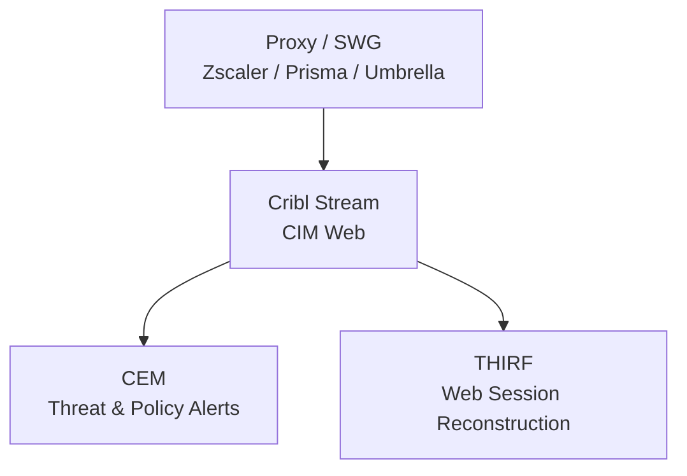

# Endpoint Security Logging Data Model: Proxies and Secure Web Gateways (SWG)

**Version:** 1.0  
**Date:** 2026-10-12  
**Alignment:** OMB M-26-14 (CEM + THIRF), CISA LRA (Category 2: Network Activity; supports Object/Resource and Security Alerts), Splunk CIM (primary: Web, Network_Traffic; secondary: Proxy), Zero Trust Visibility & Analytics.

**Primary solutions:** Zscaler, Palo Alto Prisma Access, Cisco Umbrella, Forcepoint, F5 (web), common federal SWG/proxy platforms.

## 1. Category Overview
Proxies and Secure Web Gateways provide visibility into outbound web traffic, URL filtering decisions, and often user attribution that network firewalls alone cannot supply.

## 2. Operational Purpose & Security Rationale
Essential for detecting data exfiltration, malicious downloads, and policy violations. Complements firewall and EDR telemetry for full network activity coverage required by the LRA.

## 3. Key Questions the Model Must Answer
- Who accessed what URL or domain, from which source, and was it allowed or blocked? (CEM, THIRF)
- What was the category, risk score, or threat intelligence match? (CEM)
- What volume of data was transferred? (Investigation, DLP context)
- Can the session be correlated to identity and endpoint process? (Zero Trust, THIRF)

## 4. Required Event Classes / Log Sources
| Log Source | Priority | Notes |
|------------|----------|-------|
| Web access / transaction logs | Must Have | URL, action, user, bytes |
| Threat / malware blocked events | Must Have | |
| SSL/TLS inspection metadata | Should Have | |
| Policy violation / DLP alerts | Should Have | |

## 5. Critical Attributes / Fields Table
| Field Name | Description | Why It Matters | CIM Mapping | Example | Collection Notes |
|------------|-------------|----------------|-------------|---------|------------------|
| timestamp | Event time | Timeline | `_time` | 2026-10-12T19:00:00Z | |
| user | Authenticated user | Identity | Web.user | jane.doe | |
| src / src_ip | Client IP | Origin | Web.src | 10.1.2.50 | |
| url / dest | Full URL or domain | Target | Web.url | https://malicious.example | |
| action | allowed, blocked | Outcome | Web.action | blocked | |
| http_method | GET, POST | Context | Web.http_method | POST | |
| bytes_out / bytes_in | Data volume | Exfil detection | Web.bytes | 1048576 | |
| category / threat_name | URL category or threat | Prioritization | Web.category | malware | |
| vendor_product | SWG platform | Source | Web.vendor_product | Zscaler | |

## 6. CIM Alignment
**Primary:** Web  
**Secondary:** Network_Traffic, Proxy

## 7. CEM, THIRF & CSIRC Enablement Notes
Supports real-time blocking alerts and reconstruction of web-based initial access or exfiltration.

## 8. Collection, Normalization & Maturity Guidance
Syslog or API via Cribl Stream. Normalize to CIM Web.

## 9. Stack Comparison Template
| Requirement | Current State | Gap | Remediation | Owner | Target Date |
|-------------|---------------|-----|-------------|-------|-------------|
| User-attributed web transactions | | | | | |
| Allow/block + category | | | | | |
| Bytes transferred | | | | | |
| CIM Web normalization | | | | | |

